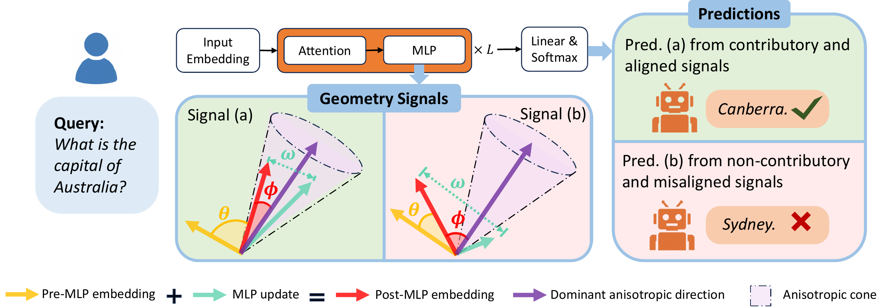

# Geometry-Calibrated Conformal Abstention

This repository implements geometry-calibrated conformal abstention (Geo-CA) for language-model question answering. It extracts layerwise logits, hidden states, and attention/MLP contributions, uses geometric features to calibrate confidence, and evaluates conformal abstention against uncertainty-estimation baselines.

[](method.pdf)

*Method overview. Click the figure to open the PDF.*

## Environment

Download `Geo_CA_env.tar.gz`, `LLaMA-Factory-source.tar.gz`, and `baseline_env.tar.gz` from the [Hugging Face bucket](https://huggingface.co/buckets/rxu0112/Geometry-calibrated-conformal-abstention). On Linux x86-64 with Conda initialized in Bash and a compatible NVIDIA driver, run the following from the directory containing the archives:

```bash
(
set -e
conda activate base

conda_root="$(conda info --base)"
geo_ca_dir="$conda_root/envs/Geo_CA_env"
baseline_dir="$conda_root/envs/baseline_env"
mkdir "$geo_ca_dir" "$baseline_dir"

# Geo-CA environment
tar -xzf Geo_CA_env.tar.gz -C "$geo_ca_dir"
mkdir -p "$geo_ca_dir/editable_sources"
tar -xzf LLaMA-Factory-source.tar.gz -C "$geo_ca_dir/editable_sources"
conda activate "$geo_ca_dir"
conda-unpack
python -m pip install \
    --no-index --no-deps --no-build-isolation --force-reinstall \
    -e "$geo_ca_dir/editable_sources/LLaMA-Factory"

# Baseline environment
tar -xzf baseline_env.tar.gz -C "$baseline_dir"
conda activate "$baseline_dir"
conda-unpack
)
```

Use new destination directories and keep the restored folders in place. Activate `Geo_CA_env` for extraction, correctness evaluation, Geo-CA, and ablations; activate `baseline_env` for all scripts under `baselines/`:

```bash
conda activate Geo_CA_env
# For baseline scripts:
conda activate baseline_env
```

## Models and datasets

| Model identifier | Hugging Face checkpoint |
|---|---|
| `Llama-3.2-3B-Instruct` | `meta-llama/Llama-3.2-3B-Instruct` |
| `Llama-3-8B-Instruct` | `meta-llama/Meta-Llama-3-8B-Instruct` |
| `Gemma-3-4B-it` | `google/gemma-3-4b-it` |

Datasets: `sciq`, `simple_questions_wiki`, `nq`, `truthfulQA`, `gsm8k`, and `common`. Prepared inputs are provided under `processed_data/<dataset>/prepared.json`.

## Main experiment

Download the complete `results/` folder from the [Hugging Face bucket](https://huggingface.co/buckets/rxu0112/Geometry-calibrated-conformal-abstention) and place it at the repository root, alongside `processed_data/`, preserving its directory structure.

Run the commands below from the repository root using `python -m`:

```bash
cd Geometry-calibrated-conformal-abstention
conda activate Geo_CA_env
```

Extraction, correctness evaluation, and baseline scoring run one model/dataset combination at a time; run them separately for each combination you need. Feature computation, calibrator training, baseline data preparation, and conformal evaluation process all six datasets and all three models automatically. Before recomputing saved outputs, follow the [rerun conventions](docs/reproduction.md#output-and-rerun-conventions).

### 1. Extract representations

For example, extract representations for SciQ with `Llama-3.2-3B-Instruct`:

```bash
python -m llama_representation.llama_3B_logit --dataset sciq --device cuda:0
python -m llama_representation.llama_3B_contri --dataset sciq --metric manhattan --device cuda:0
```

These scripts output `<dataset>_lens_results.pkl` and `<dataset>_contri_results_manhattan.pkl` under `results/<model>/<dataset>/`.

### 2. Evaluate correctness

Choose the [evaluation route for each dataset](docs/reproduction.md#2-evaluate-answer-correctness). For example, for SciQ with `Llama-3.2-3B-Instruct`:

```bash
python -m correctness_eval.short_hhem --dataset sciq --model Llama-3.2-3B-Instruct
```

Configure the API client in `correctness_eval/short_gpt.py`. Run the following example once with `judgement_model = "gpt-4o"`, then again with `judgement_model = "gpt-5.1"`. Both judge files are required for SciQ before computing features.

```bash
python -m correctness_eval.short_gpt --dataset sciq --model Llama-3.2-3B-Instruct
```

### 3. Compute features and train the calibrator

To compute features and train calibrators for all 18 model/dataset combinations, keep `metric = 'manhattan'` in `Geo-CA/feature_computation.py` and run:

```bash
python -m Geo-CA.feature_computation
python -m Geo-CA.calibrator_training
```

### 4. Run the baselines

Prepare the baseline data for all configurations:

```bash
conda activate baseline_env
python -m baselines.baseline_data_prepare
```

For example, score SciQ with `Llama-3.2-3B-Instruct`:

```bash
python -m baselines.AttentionScore --dataset sciq --model Llama-3.2-3B-Instruct --device cuda:0
python -m baselines.Perplexity --dataset sciq --model Llama-3.2-3B-Instruct --device cuda:0
python -m baselines.SemanticEntropy --dataset sciq --model Llama-3.2-3B-Instruct --device cuda:0
python -m baselines.SAR --dataset sciq --model Llama-3.2-3B-Instruct --device cuda:0
python -m baselines.EigenScore --dataset sciq --model Llama-3.2-3B-Instruct --device cuda:0
python -m baselines.Focus --dataset sciq --model Llama-3.2-3B-Instruct --device cuda:0
python -m baselines.PTrue --dataset sciq --model Llama-3.2-3B-Instruct --device cuda:0
python -m baselines.ATRMD --dataset sciq --model Llama-3.2-3B-Instruct --device cuda:0
```

### 5. Evaluate conformal abstention

Set `calibrated_baseline = False` in `Geo-CA/conformal_abstaining.py` to evaluate all 18 configurations with the original baseline scores:

```bash
conda activate Geo_CA_env
python -m Geo-CA.conformal_abstaining
```

Results are saved to `results/<model>/<dataset>/test/comparison.pkl` for each configuration.

The script skips methods already present in the comparison file; move that file aside before recomputing it.

## Full reproduction

See the [reproduction guide](docs/reproduction.md) for detailed configuration instructions, ablation experiments and their comparison tables, output files, and rerun conventions.
